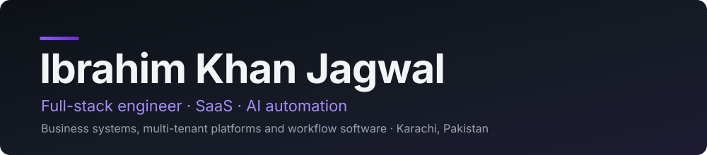

Portfolio guide mascot — an illustration, not a chatbot. Click it to open the portfolio.

### [**Open the portfolio →**](https://ibrahim-khan-jagwal.vercel.app/)

## About

I build web applications and business software, with a focus on modular SaaS, operational workflows and automation. My work spans interfaces, APIs, relational data models and deployment, with attention to who can access what, how approvals move and how records stay consistent.

**Current focus:** multi-tenant platforms, role-based access and AI-assisted workflows.

## Selected projects

| Project | What it is | Stack | Link |
| :--- | :--- | :--- | :--- |
| **Mera School** | School operations: academics, attendance, exams, fees and tenant-safe administration | Next.js, Prisma, RBAC, MFA | [Live](https://mera-school.ua-technologies.com/) |
| **Dead Sec** | Privacy-first messaging and file sharing with client-side encryption | Web Crypto, PostgreSQL | [Live](https://dead-sec.ua-technologies.com/) |
| **Hospital Management System** | Modular healthcare operations with role-controlled records | TypeScript, REST APIs, RBAC | [Live](https://hms.ua-technologies.com/login) |
| **Mera Bazaar** | Online shopping platform where businesses manage digital storefronts | Next.js, Express, PostgreSQL | [Live](https://mera-bazaar.com/) |
| **Mera Ashiana** | Real-estate marketplace for homes, apartments and plots | React, Node.js, MongoDB | [Live](https://mera-ashiana.com/) |
| **Business Quotation System** | Preparing and managing customer quotations | Next.js | [Live](https://quotation-iota.vercel.app/) · [Source](https://github.com/IKJ-work/quotation) |

More, including case studies, on the [portfolio](https://ibrahim-khan-jagwal.vercel.app/).

## Stack

| Area | Technologies |
| :--- | :--- |
| Frontend | React, Next.js, TypeScript, Tailwind CSS |
| Backend | Node.js, Express, PHP / Laravel, REST APIs |
| Data | PostgreSQL, MongoDB, MySQL, Prisma, Redis |
| Automation & AI | AI agents, Playwright, n8n / MCP |
| Deployment | Docker, Linux / Nginx, AWS EC2, Cloudflare, Vercel |

## Engineering approach

- **Start from the workflow:** identify users, decisions and exceptions before choosing features.
- **Model the rules:** define ownership, permissions, data relationships and state changes explicitly.
- **Keep boundaries clear:** interfaces, services and business logic stay separate and readable.
- **Check the important paths:** access control, data integrity and failure handling.

## Contact

**[Portfolio](https://ibrahim-khan-jagwal.vercel.app/)** · [Email](mailto:ibrahim.khan.jagwal@gmail.com) · [LinkedIn](https://www.linkedin.com/in/ibrahim-khan-jagwal/) · [UA Technologies](https://www.ua-technologies.com/)

